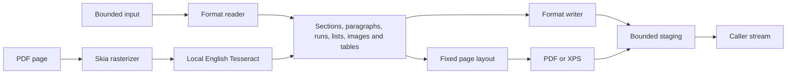

# Architecture and implementation status

Unreleased #142 direct table borders and clear RGB shading stay on the table model
through cloning and DOCX writing. Managed layout, HTML and ODT compute the
applicable outside and inside edges and cell fills from the current rows.
A bounded table-style chain retains whole-table border and clear-shading
properties, resolves inheritance at layout time and is written back as editable
DOCX styles with collision-safe identifiers. A qualified table-look mask selects
row, column, corner and single-width band fills without flattening the style or
the mask in DOCX. Non-DOCX output that relies on inherited conditional regions
or an omitted band size is diagnosed. The resolver uses Office's documented
region order and reports its difference from OOXML's order. Bounded
explicit band sizes remain editable in DOCX; unqualified rendered sizes,
unsupported style properties, conflicts and pagination are diagnosed.
Used implicit table defaults retain document-level identity and per-table omission
of explicit references; cloning and compatible composition preserve that state.
Unqualified static default rendering and conflicting composition are explicit.

Unreleased review-display work creates a detached marked model from admitted body
and simple-cell text revisions. Ordinary managed PDF and SVG render that snapshot
through the shared layout without modifying the source review store; unsupported
history, structured owners and output profiles fail explicitly. An explicit numbered
end-annotation policy maps supported classic comments, formatting and paired moves
to source anchors without margin callout placement. See the
[review profile](review-workflows.md#unreleased-source-detached-text-revision-display).

Unreleased template-format work adds DOTX/OTT package identities and bounded
byte-based inspection, with explicit unknown and unsupported outcomes. The
[template-format profile](template-formats.md) describes the pending directions
and stream contract.

The pending matrix-equation work extends the immutable expression graph and closed
OMML adapter. The managed layout positions bounded cells using column extents and
the caller's MATH axis and leading; it retains the existing vector and logical-text
paths. Other equation and output profiles remain separate.

Pending n-ary expressions retain a closed operator and optional limit semantics in
the immutable graph and OMML adapter. Managed layout uses the selected MATH font's
display variants, assemblies and limit metrics, with an explicit size fallback.

Unreleased DOCX reading also consults the bounded local theme and settings before
resolving text styles. It computes selected Latin font families and RGB colors for
rendering, and reconstructs a bounded scheme and selected editable text references
for DOCX. It retains loss diagnostics for unsupported theme semantics and rejects
conflicting document themes in composition. The [fidelity profile](document-fidelity.md#unreleased-source-bounded-theme-appearance)
records fallback and combination limits.

## 1.5.0 roadmap #102 delivery

The [release notes](releases/1.5.0.md), [capability matrix](roadmap-102-capability-matrix.json)
and [qualification record](roadmap-102-p6-qualification.md) describe the P1–P6 batch.
The bounded fields, controls, reports, review and drawing additions ship together;
all five target frameworks and existing platform limits remain. Historical results
below retain their original source/package identities.

The proposed [template compatibility plan](template-compatibility-plan-design.md)
describes a future bounded, immutable preflight contract. It does not add runtime
behavior; existing inspection and conversion continue to use their current APIs.

## P4/P5 review and drawing profile

Run-format and paired paragraph-move history retain explicit review ownership;
section and story comparison uses bounded shared work and shared-part identities.
Quarter-turn, fit and linked-box layout retain editable source structure and use
managed fixed-page geometry. A small vector profile reuses anchored drawing ownership
and paints managed paths. See the [profile and exclusions](roadmap-102-p4-p5.md).

## P3 reports — merged source

PR #135 keeps a bounded second block-control owner for one nested master-detail
region. Cloning remaps identities and lookup walks an explicit item-scope stack.
Cross-tabs build bounded simple tables with a conservative fit check; fragment
insertion snapshots a separate admitted session, remaps metadata and commits a
dedicated bookmark replacement atomically. See the
[source profile](editing-and-templates.md#mixed-report-regions--merged-source).
An unreleased cell-destination extension updates the selected cell's block and
paragraph indexes together; host table geometry remains owned by the destination.
Only simple top-level body cells are admitted, and the broader #146 field work
and qualification remain open. Explicit field opt-in preserves admitted instructions,
isolates local reference/counter identities and makes stale caches visible to callers.

## P2 control store — merged source

The [P2 source profile](content-controls.md) uses a private typed-control store
separate from executable TemplateControl tags. Owner IDs survive shared cloning;
serialized transactions validate handles/locks and admit metadata, parts, display
and work before commit. XML binding uses a bounded singleton child/attribute walker,
never a general XPath engine or implicit synchronization. DOCX emits admitted
schema-ordered control metadata/parts; managed static output resolves checkbox
fallback and bounded underline strokes only for fixed output. Explicit display views
keep Unicode text and bounded private render provenance until PDF/XPS save; text
exports only flatten. Per-version immutable snapshot caching avoids repeated owner
indexing, and final owner checks reject bookmarks attached after initial parsing.
Unreleased source additionally admits bounded glossary categories and four strictly
whitelisted local metadata parts. The store retains validated resource bytes and
relationship identities through cloning, while aggregate control limits cover them.
Richer glossary graphs remain rejected. No dependency or target change is added.

## Merged roadmap #102 P1 implementation

The [P1 source profile](roadmap-102-p1.md) adds immutable typed custom-property snapshots, bounded retained scalar-field trees and paragraph style identities. Field evaluation stays local and deterministic; running headers resolve after body pagination with bounded reservation passes. DOCX absent-value layout policy is separate from source-explicit formatting. Managed implicit tables reuse bounded sizing and safe text measurement. No runtime dependency or target framework changes.

## 1.4.0 roadmap #99 profile

Version 1.4.0 extends the 1.3.0 profiles with the bounded changes in
[roadmap-99-implementation.md](roadmap-99-implementation.md): direct HTML/ODT PDF export,
chart binding, scalar fields, structural comparison and qualified layout/native/object
combinations. The [1.4.0 release notes](releases/1.4.0.md) record compatibility and
qualification requirements. Earlier release receipts below remain historical evidence.

## Released 1.3.0 profile

Release 1.3.0 adds immutable admitted chart-part graphs and OMML expression trees to object runs. Cloning shares immutable bytes; composition remaps placements, DOCX writing rebuilds owner names/relationships, and fixed layout emits managed chart/math primitives. Native ordinary text retains logical carriers independently of visual glyph order. See [P2 boundaries and capability matrix](p2-objects-typography.md).

## Merged P1 implementation

Merged PR #85 adds immutable explicit column geometry with active-width
text/table/note layout, detached report-data preprocessing and contiguous body repeat
regions. In the 1.5.0 release, an independent ODF package layer and managed adapter
enable DOCX ↔ ODT and ODT remains outside document-session loading/saving. The
unreleased template work adds bounded ODT/OTT session support. See [ODT](odt.md),
[report preprocessing](report-preprocessing.md) and [review workflows](review-workflows.md).

ReviewStore retains admitted plain-text revisions and classic comment intervals.
Session/version handles, clone-before-commit decisions/recording and explicit detached
views prevent implicit review decisions. Pinned Unicode 17 tables support grapheme
validation and bounded matching-structure comparison. These features and P2 objects ship in 1.3.0; cryptographic features are cancelled. No runtime dependency is added.

The merged bucket 4 profile extends the earlier 30 directions to 36 with HTML input and RTF exchanges.
See [interoperability profiles](interoperability.md) for the supported 1.2.0 subset.
They implement the documented desktop feature profile, with explicit fidelity limits.
The public namespace is `WordNet`; the assembly and package ID are `wordnet`.
All targets retain matching APIs:
`net462;net472;netstandard2.0;net8.0;net10.0`.

The [implementation plan](implementation-plan.md) separates merged roadmap work,
pending PRs and published-package capabilities. Business-document profiles landed in
PR #34; the editing/template implementation below merged in PR #35 as `0b2af843`.
Both ship in package 1.2.0. Bucket 4's HTML/RTF, typography, accessibility, preview and import implementation
merged in PR #37 as `44c9e362` and also ships in 1.2.0. [Provider decisions](interoperability-design.md)
keep managed export offline and native shaping/rasterization explicit.

The P0 adoption work in PR [#83](https://github.com/kirakosyan/word.net/pull/83) adds independently captured reference evidence and executable invoice/report recipes over the existing public API. It changes no engine/provider boundary, public API or target framework. Reference findings identify the measured engine and retain every failed verdict, with wordnet source triage locations only for wordnet results. See [the comparison report](comparison-p0.md) and [recipe guide](../examples/WordNet.Automation/README.md).

## Pipeline

The [editing/template API](editing-template-design.md) adds serialized `WordDocument`
sessions over private semantic-model copies. Mutations admit aggregate resources
before committing, and saves use independent copies. Editing loads preserve merge
instructions and tagged controls without changing ordinary conversion's cache
behavior. Composition remaps identifiers; template execution uses bounded named
data, repeat rows and truth-value conditions. See the [usage guide](editing-and-templates.md).

`WordConverter` dispatches Word exchanges; XPS has no reader. Per-call
`ConversionContext` owns cancellation and grouped diagnostics. Options/results
have per-call snapshots for mutable HTML/font settings; callers configure those
collections before concurrent use. Provider types stay outside the public API.

`WordConverter.Inspect/InspectAsync` reuse source parsing and destination fidelity
checks, with optional fixed-page layout and no output serialization. Diagnostics
retain grouping and add bounded stage/source occurrences. DOCX block locations
flow from indexed source XML into feature checks and layout; adapters without
precise mapping explicitly use document-level identifiers. See
[the design decision](preflight-comparison-design.md) and [diagnostics](diagnostics.md).

Core export is managed. `wordnet.Fonts` supplies embedded OFL resources. Optional
`wordnet.Ocr` contains PDF input, Skia and Tesseract integration; a per-call managed
delegate bridge loads it only for PDF input. Missing that package yields a setup
error. Caller stream ownership and original public signatures remain. GAC, merged
and strong-name variants are waived under the NuGet-only deployment decision.

## Adapters

| Adapter | Implementation and boundary |
| --- | --- |
| DOCX | Own bounded OPC reader/writer and basic styles; Open XML SDK validates test outputs |
| DOC | Own FIB/CLX, CHPX/PAPX pages, styles and simple tables; OpenMcdf supplies compound storage; see the binary Word profile |
| Markdown / text | Markdig syntax mapping; own serialization and strict UTF-8 paragraph conversion |
| EPUB | Bounded ZIP/XML, OPF spine ordering and EPUB 3 serialization |
| Ebook XHTML | AngleSharp without loaders/scripts; own headings/emphasis/links/simple-table mapping |
| MOBI / KF8 | Own PalmDB, PalmDOC decompression, headers and skeleton/fragment handling; no DRM/HUFF/CDIC/hybrid containers |
| PDF | PdfPig reading/writing, content-order extraction and optional Skia rasterization |
| XPS | Own XPS 2005 package relationships, glyph positions and embedded fonts |
| HTML output | Own UTF-8 HTML5 serializer, inline CSS/data images, nested lists/tables and safe links; no loader or executable content |

The model carries absolute font sizes/RGB colors, decimal/bullet lists, inline PNG/JPEG
with physical dimensions, section geometry, paragraph spacing/indentation/pagination,
multi-paragraph cells, spans, repeating headers and row controls. It also carries bounded multilevel numbering, drawings, notes and section labels;
editable charts/equations use the bounded 1.3.0 profile above. DOCX revisions render their accepted state
with an explicit fidelity warning in BestEffort/Lenient; Strict rejects revision
and comment loss before output is copied. Detected
losses are diagnosed. See the [fidelity profile](document-fidelity.md).
DOCX bold/italic style inheritance follows published toggle semantics; direct values
are absolute. Sources include [WordprocessingML properties](https://learn.microsoft.com/en-us/dotnet/api/documentformat.openxml.wordprocessing.bold),
[toggle semantics](https://learn.microsoft.com/en-us/openspecs/office_standards/ms-oi29500/f7130225-2368-48f3-acae-a9d278d0fb25),
[MS-DOC](https://learn.microsoft.com/en-us/openspecs/office_file_formats/ms-doc/),
[EPUB 3.3](https://www.w3.org/TR/epub-33/) and the community's
[MOBI field reference](https://wiki.mobileread.com/wiki/MOBI).

## Layout and OCR

Shared layout uses section geometry (A4 when unspecified), pinned Noto Sans, font advances, wrapping, pagination, headings
and absolute table/cell widths and padding (equal-width fallback). Mixed font sizes and
images determine line height; dimensions are preserved or oversized content fails.
Left/center/right alignment is applied independently to
each measured line, including table cells; trailing spaces do not shift visible alignment.
The model carries physical alignment through Word and ebook adapters. DOCX document
defaults, based-on styles and direct overrides resolve before writing. Markdown supports
column alignment but diagnoses aligned prose or conflicting alignment within a column.
Missing glyphs and unsupported shaping fail. Ordinary long table rows split between
lines and repeat headers. Non-splitting rows and vertically merged groups must fit a page.
Keep chains have bounded lookahead; unsupported keep-with-table controls report loss.
Faithful original pagination and richer typography remain unfinished.

The enterprise export profile adds caller-selected faces, bounded TTC extraction/catalogs,
metric-compatible OFL fallbacks, subset PDF embedding and legacy horizontal `kern`
pairs and GPOS pair/class/extension positioning. Static CFF outlines are converted
to bounded quadratic glyph subsets with a sub-unit outline error bound. Variable/
color outlines, advanced ligatures and complex shaping remain outside the profile.
Catalog resolution ranks OS/2 weights against regular (400) or bold (700),
preserving the requested italic style. Only used font faces are parsed;
layout/font state is per-call. Fixed-clock metadata
and normalized trailer identity make PDF output deterministic. PAGE/NUMPAGES layout
runs two passes (a third if the count changes); stories select first/even/default
per section, reserve vertical space and have independent numbering state. Body page
fields retain their field tokens in prepared lines and evaluate when the line is
placed, so page breaks and paragraph movement use the destination page. Cached DOC/DOCX field results retain
their original paragraph/table-cell destinations, including nested fields. HTML
retains cached pagination fields and never invokes fixed-page layout. Its optional
header/footer blocks use only the first page's applicable story variants.

The [business fidelity profiles](business-fidelity-design.md) extend shared layout
with recursively measured table bands, collapsed border primitives, bounded autofit,
clipped/transformed raster frames, drawing exclusions, sequential columns, page labels,
footnote reservations and calculated bookmark/TOC references. These remain internal
model extensions with no new runtime dependencies or public API. DOCX preserves the
supported editable structure; binary DOC retains explicit subset diagnostics.

PDF import always reports reconstruction loss. Digital text becomes editable paragraphs.
With OCR configured, image-only pages and pages with an image occupying at least half
the page area are rasterized and recognized once, avoiding duplicate digital overlays.
Ordinary illustrations are retained alongside text in geometric reading order. Large
image-only scans require OCR; simple smaller standalone images can be retained directly.
Image placement/clipping reconstruction has explicit diagnostics.

The OCR wrapper loads a caller-specified absolute Tesseract 5 C API library. A synchronized
cache keeps one native loader reference per canonical configured path for the process
lifetime, preventing unload while native dependencies retain workers or thread-local state.
Each call owns and releases its engine and image/text buffers. Local English data/native
dependencies are explicitly provisioned.
Recognition returns English printed paragraphs, not handwriting or reconstructed tables.
The separate `ReadTextColumns` option can reorder two known prose columns down the
left column then the right, preserving paragraph boundaries within each column.
It is disabled by default because forms and tables can have the same gutter geometry.
The optional `CorrectOrientation` overload tries right-angle rotation and up to five degrees
of skew correction using bounded dark-pixel projection scoring. Selection compares OCR
confidence, reusing one engine across candidates and avoiding zero-degree raster copies.
Preprocessing remains opt-in and requires output review. Existing constructor
signatures and default correction-disabled behavior are preserved.
Confidence diagnostics average the per-page mean confidences across all OCR pages and
include the page count; they are information, not an accuracy guarantee. Whole-page OCR
reports image loss and replacement of existing digital text separately from reconstruction.

## Fidelity and resources

Strict mode rejects detected losses before copying output. Best effort retains supported
content with warnings. DOC import always reports formatting loss; PDF always reports
reconstruction loss. This is not a guarantee of lossless interpretation of arbitrary files.

ZIP readers check entry counts, duplicates, paths and aggregate declared expansion.
EPUB resolves normalized relative parent segments only inside its package; DOCX uses
a stricter canonical-path profile. XML rejects DTDs/entities and bounds characters/depth.
HTML has no external loader and is depth checked before mapping. Binary readers validate
offsets, counts and decompressed content. No scripts/macros or remote resources execute.

Input/output, characters, nesting, pages and raster/embedded-image pixel admission checks
are not hard process-memory/CPU limits. Provider decoding, fonts and native allocations
consume additional memory. DOC limits apply per named stream; XML limits per part plus
aggregate model text.

## Streams and cancellation

Caller streams stay open; reading/writing starts at current positions without truncation.
Reject identical streams; callers must avoid wrappers over the same resource.
Input may read one extra byte to detect overflow. Output is staged within its byte limit.
Parsing/loss/validation failures leave caller output untouched; final-copy cancellation or
I/O errors can leave partial data.

Async paths perform async I/O without hidden worker threads. Parser, rasterizer and
native recognition calls execute synchronously. Tesseract's progress monitor receives the
cancellation token during recognition. Other parser/rasterizer/native setup operations may
not cooperate promptly. Hard deadlines require [host isolation](hosting.md).

## Deployment

Tesseract and language data are separately provisioned. Skia and PDF raster codecs bring
native dependencies whose assets must match the host. No Office automation/service is
required. Native Windows/Linux x64 and ARM64 CI lanes execute the complete conversion/OCR
suite on .NET 8 and .NET 10; Windows x64 also runs Framework. The Android harness shares
the cases but Android is outside the 1.0 release scope. Native Linux runs use default runtime settings. Linux uses fontconfig-enabled
Skia assets and installed fonts for unembedded PDF text. macOS is deferred; broader
OS coverage and trimming/AOT remain outstanding. Actual Framework 4.7.2 x64 requires
the documented legacy JIT application configuration. See [testing](testing.md),
the [DOC profile](doc-format.md) and the [implementation plan](implementation-plan.md).

Bucket 4 review fixes keep render font/outline/path caches in the conversion context,
shared across preview pages and keyed by the actual font byte-array identity. Admission
charges each decoded glyph once; no mutable state crosses conversion calls. Tagged
annotations are admitted against source semantics before page annotation creation, and
ParentTree key/value pairs are numerically ordered. PDF reconstruction orders flow blocks
before assigning gaps; page-relative illustration anchors share an existing paragraph,
and adjacent glyphs with the same supported appearance share one editable run.

Native typography copies admitted font bytes into a HarfBuzz-owned blob while the
managed source is briefly pinned. The native face/font/blob live together for the
shaping session; no stream-created pointer to movable managed memory is retained.

## Bucket 5 designs (merged; implementation deferred)

PR #39 merged the [decision index](later-design-decisions.md), which proposes an ODF adapter, range-aware
review state, explicit authenticated DOCX-envelope utilities and a validated retained
chart/OMML graph. Each has bounded APIs, losses and independent acceptance gates.
These are prospective architecture contracts; no such model nodes, format, crypto
utility or object editor is implemented by this design PR. Existing offline managed
export, opt-in native providers and five-target compatibility remain the baseline.

## 1.2.0 release profile

The implemented additions above are included in the published 1.2.0 package profile.
No provider/API/runtime behavior changes accompany the version increment; package
validation now compares against the published 1.1.0 API. See [release notes](releases/1.2.0.md)
and [readiness](release-1.2.0-readiness.md) for publication and actual-runtime gates.

The [hosted minimum-runtime lane](hosted-minimum-runtime.md) runs prepared source
and immutable-package tests inside real Windows 2019 guests on isolated Linux/KVM
runners. Independent runtime/JIT/hash/suite checks and verified cleanup accompany
the existing native desktop lanes. This qualification infrastructure introduces no
converter provider or portable runtime dependency.

The 1.2.1 presentation patch changes package/producer metadata, README badges and
documentation links. Engine and provider boundaries retain the 1.2.0 contracts;
API comparison uses published 1.2.0. CI actions explicitly target Node.js 24, and
SDK selection stays at 10.0.401 to preserve the committed Android restore inputs.
