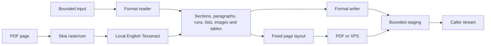

# Architecture and implementation status

All 28 Word-related directions have implementations and real acceptance tests.
They implement limited development profiles, not complete document fidelity.
The public namespace is `WordNet`; the assembly and package ID are `wordnet`.
All targets retain matching APIs:
`net472;netstandard2.0;net8.0;net10.0`.

## Pipeline

`WordConverter` dispatches Word exchanges; XPS has no reader. Per-call
`ConversionContext` owns cancellation and grouped diagnostics. Options/results
are immutable; provider types stay outside the public API.

## Adapters

| Adapter | Implementation and boundary |
| --- | --- |
| DOCX | Own bounded OPC reader/writer and basic styles; Open XML SDK validates test outputs |
| DOC | Own FIB/CLX, CHPX/PAPX pages, styles and simple tables; OpenMcdf supplies compound storage; see the binary Word profile |
| Markdown / text | Markdig syntax mapping; own serialization and strict UTF-8 paragraph conversion |
| EPUB | Bounded ZIP/XML, OPF spine ordering and EPUB 3 serialization |
| Ebook XHTML | AngleSharp without loaders/scripts; own headings/emphasis/links/simple-table mapping |
| MOBI / KF8 | Own PalmDB, PalmDOC decompression, headers and skeleton/fragment handling; no DRM/HUFF/CDIC/hybrid containers |
| PDF | PdfPig reading/writing, content-order extraction and optional Skia rasterization |
| XPS | Own XPS 2005 package relationships, glyph positions and embedded fonts |

The model carries absolute font sizes/RGB colors, decimal/bullet lists, inline PNG/JPEG
with physical dimensions, section geometry, paragraph spacing/indentation/pagination,
multi-paragraph cells, spans, repeating headers and row controls. It has no advanced
numbering, revisions or editable charts/equations yet. Detected
losses are diagnosed. See the [fidelity profile](document-fidelity.md).
DOCX bold/italic style inheritance follows published toggle semantics; direct values
are absolute. Sources include [WordprocessingML properties](https://learn.microsoft.com/en-us/dotnet/api/documentformat.openxml.wordprocessing.bold),
[toggle semantics](https://learn.microsoft.com/en-us/openspecs/office_standards/ms-oi29500/f7130225-2368-48f3-acae-a9d278d0fb25),
[MS-DOC](https://learn.microsoft.com/en-us/openspecs/office_file_formats/ms-doc/),
[EPUB 3.3](https://www.w3.org/TR/epub-33/) and the community's
[MOBI field reference](https://wiki.mobileread.com/wiki/MOBI).

## Layout and OCR

Shared layout uses section geometry (A4 when unspecified), pinned Noto Sans, font advances, wrapping, pagination, headings
and absolute table/cell widths and padding (equal-width fallback). Mixed font sizes and
images determine line height; dimensions are preserved or oversized content fails.
Left/center/right alignment is applied independently to
each measured line, including table cells; trailing spaces do not shift visible alignment.
The model carries physical alignment through Word and ebook adapters. DOCX document
defaults, based-on styles and direct overrides resolve before writing. Markdown supports
column alignment but diagnoses aligned prose or conflicting alignment within a column.
Missing glyphs and unsupported shaping fail. Ordinary long table rows split between
lines and repeat headers. Non-splitting rows and vertically merged groups must fit a page.
Keep chains have bounded lookahead; unsupported keep-with-table controls report loss.
Faithful original pagination and richer typography remain unfinished.

PDF import always reports reconstruction loss. Digital text becomes editable paragraphs.
With OCR configured, image-only pages and pages with an image occupying at least half
the page area are rasterized and recognized once, avoiding duplicate digital overlays.
Ordinary illustrations are retained alongside text in geometric reading order. Large
image-only scans require OCR; simple smaller standalone images can be retained directly.
Image placement/clipping reconstruction has explicit diagnostics.

The OCR wrapper loads a caller-specified absolute Tesseract 5 C API library. A synchronized
cache keeps one native loader reference per canonical configured path for the process
lifetime, preventing unload while native dependencies retain workers or thread-local state.
Each call owns and releases its engine and image/text buffers. Local English data/native
dependencies are explicitly provisioned.
Recognition returns English printed paragraphs, not handwriting or reconstructed tables.
The separate `ReadTextColumns` option can reorder two known prose columns down the
left column then the right, preserving paragraph boundaries within each column.
It is disabled by default because forms and tables can have the same gutter geometry.
The optional `CorrectOrientation` overload tries right-angle rotation and up to five degrees
of skew correction using bounded dark-pixel projection scoring. Selection compares OCR
confidence, reusing one engine across candidates and avoiding zero-degree raster copies.
Preprocessing remains opt-in and requires output review. Existing constructor
signatures and default correction-disabled behavior are preserved.
Confidence diagnostics average the per-page mean confidences across all OCR pages and
include the page count; they are information, not an accuracy guarantee. Whole-page OCR
reports image loss and replacement of existing digital text separately from reconstruction.

## Fidelity and resources

Strict mode rejects detected losses before copying output. Best effort retains supported
content with warnings. DOC import always reports formatting loss; PDF always reports
reconstruction loss. This is not a guarantee of lossless interpretation of arbitrary files.

ZIP readers check entry counts, duplicates, paths and aggregate declared expansion.
EPUB resolves normalized relative parent segments only inside its package; DOCX uses
a stricter canonical-path profile. XML rejects DTDs/entities and bounds characters/depth.
HTML has no external loader and is depth checked before mapping. Binary readers validate
offsets, counts and decompressed content. No scripts/macros or remote resources execute.

Input/output, characters, nesting, pages and raster/embedded-image pixel admission checks
are not hard process-memory/CPU limits. Provider decoding, fonts and native allocations
consume additional memory. DOC limits apply per named stream; XML limits per part plus
aggregate model text.

## Streams and cancellation

Caller streams stay open; reading/writing starts at current positions without truncation.
Reject identical streams; callers must avoid wrappers over the same resource.
Input may read one extra byte to detect overflow. Output is staged within its byte limit.
Parsing/loss/validation failures leave caller output untouched; final-copy cancellation or
I/O errors can leave partial data.

Async paths perform async I/O without hidden worker threads. Parser, rasterizer and
native recognition calls execute synchronously. Tesseract's progress monitor receives the
cancellation token during recognition. Other parser/rasterizer/native setup operations may
not cooperate promptly. Hard deadlines require [host isolation](hosting.md).

## Deployment

Tesseract and language data are separately provisioned. Skia and PDF raster codecs bring
native dependencies whose assets must match the host. No Office automation/service is
required. Native Windows/Linux x64 and ARM64 CI lanes execute the complete conversion/OCR
suite on .NET 8 and .NET 10; Windows x64 also runs Framework. An Android ARM64 device
executes the same shared cases. Native Linux runs use default runtime settings. Linux uses fontconfig-enabled
Skia assets and installed fonts for unembedded PDF text. macOS is deferred; broader
OS/device coverage and trimming/AOT remain outstanding. See [testing](testing.md),
the [DOC profile](doc-format.md) and the [implementation plan](implementation-plan.md).
