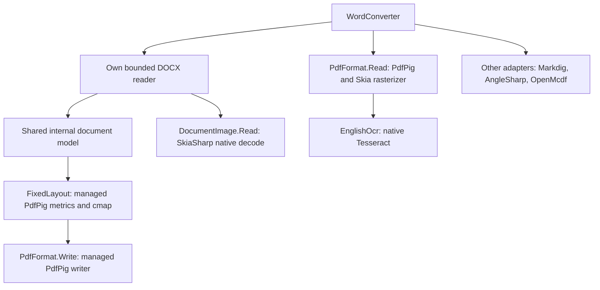

# Enterprise conversion audit (issue #4)

Audited 2026-10-15 at `8f20158ff9d1a4da0fbc267e1d17d35cee03bbd5`.
This is the M0 audit for [issue #4](https://github.com/kirakosyan/word.net/issues/4),
not a qualification of the requested enterprise feature set.

## Deployment decision

The maintainer clarified on 2026-10-15 that consumers use NuGet and do not install
the component into the GAC. The single-DLL/GAC and merged-assembly requirements
are therefore removed. Preserve the existing assembly identity and use ordinary
NuGet dependencies; do not introduce signing solely for GAC deployment.
Offline, headless operation, managed DOCX export, stream ownership, resource bounds,
and explicit fidelity diagnostics still apply.

The published Framework DLL identifies as
`wordnet, Version=1.0.0.0, Culture=neutral, PublicKeyToken=null`.
Adding a strong name would change identity and conflict with the issue's binary
compatibility requirement. Microsoft's [binary compatibility guidance](https://learn.microsoft.com/dotnet/standard/library-guidance/breaking-changes#binary-breaking-change)
confirms this; the NuGet deployment clarification removes that conflict.
No signing key or release credential was created or changed.

## Baseline dependencies and conversion path

Text-only DOCX export does not use Skia for font measurement: `FixedLayout.Create`
uses PdfPig's managed TrueType parser and writer metrics. Embedded-image validation
in `Model/DocumentImage.cs` does use `SKCodec.GetPixels`, including on DOCX import.
Consequently, moving Tesseract alone does not remove native code from DOCX export.
`PdfFormat` currently contains both import and export; OCR/native loading lives in
the same assembly under `Ocr/`. `wordnet.csproj` references the Skia renderer and Linux
native packages, and the lock file adds Windows/macOS native packages transitively.
Normal NuGet resolution therefore brings native dependencies even for text-only work.
Managed image validation and a separate optional native import/OCR package remain work.

Markdig is BSD-2-Clause, AngleSharp MIT, OpenMcdf MPL-2.0, and PdfPig Apache-2.0.
The existing notices and pinned versions must be preserved. There is no approved
ImageSharp addition or new font bundle in this audit.

## Fonts and hosting

Four OFL-licensed Noto Sans faces are manifest resources. `FixedLayout.FontBytes`
already uses `GetManifestResourceStream`, not installed fonts or the working directory.
Font metrics and glyph coverage are read with PdfPig. The model does not retain an
arbitrary requested family, and the layout always selects one of these four faces.
There is no public caller-font source, substitution policy, kerning policy or bounded
font cache. Font data is loaded per conversion. Missing glyphs currently fail.
Embedding/subsetting behavior must be asserted from generated PDF font dictionaries
before making new subsetting claims.

DOCX parsing and export use memory and caller streams. OCR checks caller-supplied
filesystem paths and maintains a synchronized, unbounded, process-lifetime native
module dictionary (`Ocr/NativeModule.cs`); it has no cache-clear operation. That native
cache belongs in the optional OCR boundary, not a managed export font cache.

## Framework feasibility and JIT evidence

An isolated `net462` project compiled the unmodified production sources with the
existing pinned runtime dependencies, explicit Framework references and embedded fonts:
**build succeeded, zero warnings/errors**. The direct command-line retarget first hit
`NU1009` because the real project's explicit reference-assemblies item is conditional
on `net472`; the isolated project supplies that item explicitly. This is a project
condition to extend, not evidence that 4.6.2 is impossible. Its restored graph includes
`System.Memory` and `System.ValueTuple`; these are ordinary NuGet dependencies under
the clarified deployment model. No actual 4.6.2 runtime was executed.

The retained 4.7.2 investigation identifies
`UglyToad.PdfPig.Images.Png.HeaderValidationResult`'s constructor and an independently
authored eight-byte signature-check constructor as reproductions. Default x64 JIT
native code incorrectly reuses a span element for later indices. The retained
`27-probe/probe.txt` reports both constructors false for valid PNG signature bytes;
`30-legacyjit/probe.txt` reports both true. The defect is outside wordnet's own source;
do not patch or vendor dependency implementation code without the appropriate review.
Replacing the export image path can avoid one affected call but does not establish
that all PDF import/other provider paths work with that JIT. Keep the documented
legacy-JIT requirement until a full actual-4.7.2 run proves otherwise.
See [the minimum-runtime evidence](minimum-runtime-qualification.md).

## Confirmed gaps at the audit baseline

| Gap | Baseline finding |
| --- | --- |
| G1 HTML | No HTML enum/dispatch/writer; ebook XHTML is an internal serializer, not an e-mail export contract. |
| G2 headers/footers | Section references are diagnosed; there are no header/footer stories in the model. |
| G3 fields | No field model, clock, page-field evaluation or two-pass layout. Cached text can survive flattening, with generic losses. |
| G4 fonts | Four fixed Noto faces; requested families are not retained. |
| G5 nested tables | Cells contain paragraphs only; nested table content is diagnosed and omitted. |
| G6 anchors/shapes | Inline PNG/JPEG only; anchored drawings and effects are diagnosed. |
| G7 justification | Model has left/center/right only; justified/distributed input is diagnosed. |
| G8 notes/sections/lists | Next-page geometry, decimal/bullet nesting and simple restarts exist; notes, other breaks and advanced labels do not. |
| G9 merge artifacts | Wrappers can retain current text but report generic block/inline losses. No complete SDT/field/revision/alternate-content policy. |
| G10 deployment | NuGet deployment accepted; managed image validation and native dependency separation remain open. |
| G11 net462 | Source compilation demonstrated; target integration and actual-runtime qualification remain open. |
| G12 pagination | Shared measured flow and keep controls exist; no measured Word parity or benchmark claim. |
| G13 degradation | BestEffort still throws on oversized layout/glyph cases; Lenient does not exist. |
| G14 page/table decoration | Borders/shading/background/watermarks are not represented by the model. |
| G15 complex scripts | Unsupported shaping fails. It must remain explicit; no bidi qualification is claimed. |

## Package and baseline verification

The retained public NuGet archive is **5,001,085 bytes** (4.77 MiB), SHA-256
`dbc966d36c80ec67f7d49de07ed2591ec9d30cc6dff684b217509331feb35049`.
Its `net472` DLL SHA-256 is
`386ea7ebfb404fa363ff726ba04c175348455302194bd19335ff5cef8f8f12b4`.
The archive itself has no `runtimes/*/native` entries, but its dependency graph brings
native assets; a ZIP-entry assertion alone would give a misleading result.
An isolated Framework consumer with only that DLL fails DOCX-to-PDF with a missing
`UglyToad.PdfPig` assembly. That single-DLL case is waived for NuGet deployment.
The retained public archive is repository-signed and differs from the pre-signing CI
archive hash in the earlier release evidence; the DLL hash matches.

Using the pinned local SDK 10.0.401, locked solution restore and all four Release
library targets passed without warnings. All **348** existing cases passed with no
failures/skips on each of .NET 8, .NET 10 and the installed Framework 4.8.1 x64 host
(Framework release key 533509). English OCR was provisioned in each launching process.
Reports/probes are under ignored `artifacts/enterprise-audit/`. These runs establish
the starting baseline only; they do not qualify the isolated net462 probe, actual
4.7.2 default JIT, other operating systems, Word parity, or enterprise performance.

## Acceptance implementation after the baseline audit

The candidate is `1.1.0-alpha.1`, with the original public API retained and stable
AssemblyVersion 1.0.0.0. It adds net462 and remains unsigned under the NuGet-only
deployment waiver. `wordnet` references only managed dependencies and `wordnet.Fonts`;
PDF input/native rasterization/OCR live in the optional `wordnet.Ocr` package.
Resources are embedded; ordinary DOCX PDF/HTML conversion uses memory/caller streams,
without Office, installed fonts, disk writes, network or native modules. Explicit
caller directory/font APIs are opt-in. The dependency graph is in [dependencies](dependencies.md).

| Requirement | Implemented behavior / deterministic degradation |
| --- | --- |
| G1 HTML | Output-only HTML5 for DOC/DOCX; inline CSS, data images, safe escaped links, lists/nested tables/merges, cell/run decoration and optional stories. DOM/safety tests. |
| G2 stories | Inherited default/first/even section headers/footers, paragraphs/images/tables/tabs and reserved body space. DOCX/DOC exchange preserves stories. Oversized stories scale/constrain with diagnostics in Lenient. |
| G3 fields | PAGE/NUMPAGES/SECTIONPAGES/DATE/TIME/TITLE/AUTHOR, sampled Clock and final pagination; preserved DOC/DOCX fields; clickable safe hyperlinks, including cached pictures. Unknown fields retain styled cached results with Info. DOC SummaryInformation retains Unicode Title/Author. |
| G4 fonts | Caller static TTF/CFF OpenType/TTC/streams/directories; exact faces, substitutions, OFL metric-compatible fallbacks; subset embedding/ToUnicode; Latin coverage/fallback diagnostics. Legacy kern and bounded GPOS pair/class/extension positioning. Adjacent equal-style tiny runs coalesce linearly. |
| G5 tables | Nested DOCX/HTML and cell borders/shading/alignment/merges; other outputs retain flattened text and diagnose decoration. Fixed-page widths, padding, repeated headers and row/group splits; Lenient constrains unusable geometry and force-splits oversized content. |
| G6 images/shapes | Managed PNG/JPEG/GIF/BMP, PNG predictor/SMask, JPEG DCT reuse. Anchors become inline with `Image.AnchorApproximated`; effects/wrapping and positioned text boxes diagnose approximation; vector logos get sized placeholders. |
| G7 alignment | Justified/distributed wrapped text in fixed layout; preserved Word alignment and HTML CSS. |
| G8 notes/sections/lists | Notes become numbered end text (`Notes.PlacedAtEnd`); unsupported section breaks/columns become next-page single-column flow; advanced list labels become decimal/bullet labels with specific diagnostics. Next-page geometry/simple lists and restarts remain supported. |
| G9 merge artifacts | Current SDT/custom XML content, accepted revisions, omitted comments with diagnostics, choice/fallback handling and cached merge/conditional field results. |
| G10/G11 deployment | Five core targets; managed NuGet closure; OCR separation; no GAC/merge/signing gate under the user's waiver. Actual-runtime evidence is separate below. |
| G12 pagination | 36/36 authored business page counts match independent Word measurements. Embedded metrics/GPOS, tab stops/leaders, paragraph spacing/indents/keep/page controls, final-page fields. Unsupported contextual/widow controls, theme/conditional styles and advanced typography diagnose loss. |
| G13 policy/API | Lenient scaling/splitting/fallback, stable grouped diagnostics and metrics; unchanged default Strict policy. Convenience byte-array helpers and Html/Font/Pdf options. Corruption, invalid caller configuration, limits, cancellation and I/O remain failures. |
| G14/G15 | Page decoration/watermarks/advanced table appearance outside the supported destinations diagnose loss. Complex scripts/RTL/shaping are explicit non-goals with diagnostics; tagged PDF is optional/unimplemented. |

This uses the issue's definition of done allowing P1 features to be explicitly
diagnosed with deterministic Lenient degradation. It does not claim full positioned
shape, theme, footnote-bottom, column or Word-layout fidelity. Cross-paragraph complex
fields may flatten block placement; total-page fields use bounded convergence passes.
Strict rejects detected losses before copying output. See [fidelity](document-fidelity.md)
and the [179-code catalog](diagnostics.md) for the supported profile.

Static CFF conversion has bounded adaptive cubic-to-quadratic error and limits on
depth, points and output size; an independent Skia raster comparison checks outlines.
The reference layout corpus now uses ReportLab plus pinned HarfBuzz shaping, retaining
the 0.03-point per-glyph tolerance. Three reviewed 72-DPI goldens remain regression
baselines, rather than Word-generated reference images.

Independent Word DOC verification found and fixed document-part termination,
PlcfHdd ordering, terminal-paragraph PAPX mapping and field-separator flags. Word
opens/prints generated five-page and first/even two-page story samples correctly.
A sanitized Word-generated DOC independently exercises the reader. No Office code,
installed fonts or customer invoice is in the repository.

## Acceptance evidence and limits

- The authored corpus has 40 DOCX inputs (38 valid, two deliberate rejects), with
  independently recorded Word 16.0 build 16.0.20430 counts and source hashes. All
  36 business-category counts match exactly; tiny-run/oversized-row stress cases
  were categorized separately before measuring. This narrow set does not qualify
  arbitrary customer templates or exact Word line breaks.
- PDF options include default PDF 1.7, optional heading outlines/compression control
  and PDF/A-2b. Pinned veraPDF 1.30.2 independently passes **38/38** archival outputs,
  including corrected XMP property uniqueness and link-annotation flags. CI repeats it.
- The image-bearing ten-page single-core comparison passed: candidate median
  **75.796 ms**, baseline **141.330 ms**, ratio **0.5363**; managed sampled peak
  **25,058,640 bytes**, conservative heap-plus-allocation upper bound **40,122,840 bytes**.
  CI compares both revisions on the same runner and enforces <300 ms, <100 MB and
  ≤25% regression. Guard tests reject mismatched/incomplete evidence. See [testing](testing.md).
- A 64-worker × 200 mixed run must produce 12,800 byte-identical PDF/HTML pairs
  under fixed Clock with no native providers. The CI gate repeats this with a
  4 GiB stress-process heap cap; this is distinct from the per-document 100 MB test.
- Locked restore, five-target Release build and 449-case source/package gates cover
  .NET 8/10 and Framework, plus explicit netstandard2.0 assets. Package validation
  compares the public API against 1.0.0. Final reports and package hashes are recorded
  alongside the build evidence; startup/compilation alone never qualifies a runtime.
- Actual Framework 4.6.2 remains unqualified (preferred, rather than required minimum).
  The fresh 4.7.2 run and native Windows/Linux x64/ARM64 CI must be recorded before
  claiming those candidate platform lanes. The documented legacy-JIT requirement
  remains: the method-level defect is reproduced outside wordnet and the issue
  explicitly allows retaining it with evidence. Android/macOS remain deferred.

GAC/single-DLL/strong naming were waived by the user. PDF tagging is optional.
No package publication or release-credential change is part of this implementation.
The private invoice acceptance run stays under `C:\test\wordnet-issue4-results`;
PDF import retains editable content but does not reconstruct its original layout.
